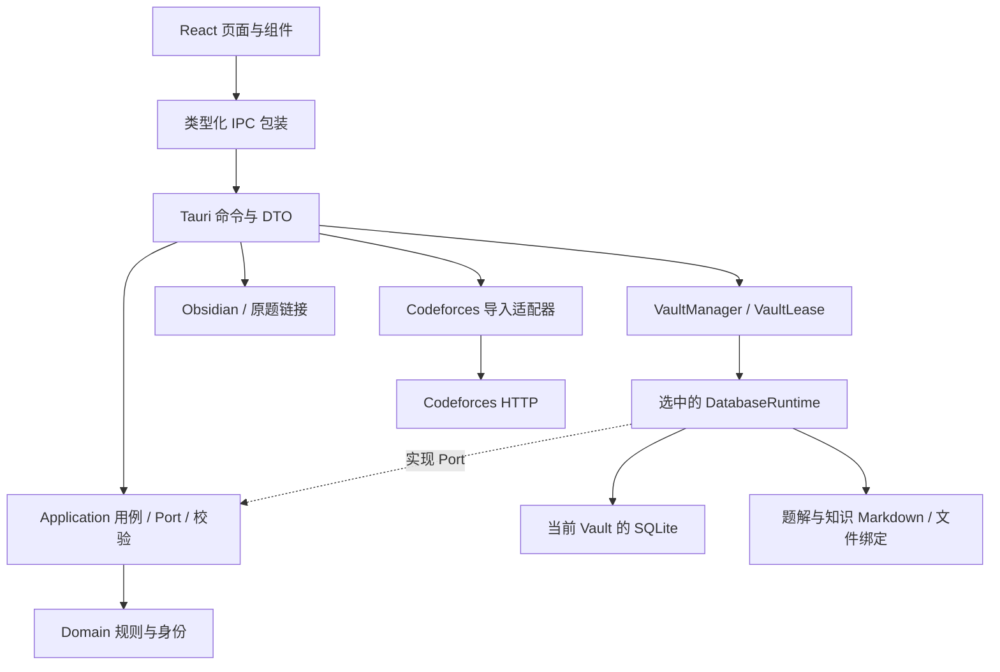
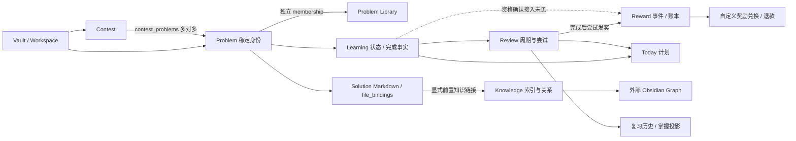

# ACM-OS Current Implementation

审计日期：2026-09-22。对象：当前工作区源码，包含未提交修改及新增文件。Git HEAD：`0e921ee261da2b061eb70f27ad4e94b9d7a93199`；该提交号本身不包含工作区全部能力。

本文记录代码可证实的实现状态，不以历史设计稿、聊天记录、旧验收日志推断当前功能。它是后续开发的现状索引；代码变化后必须同步修订，不能将本快照视为永久有效的事实。

## 1. Project Overview

ACM-OS 是本地桌面学习应用：React/TypeScript 展示页面，Tauri 提供命令边界，Rust 处理学习规则、文件与持久化。SQLite 保存系统事实；Vault 内 Markdown 保存个人题解和知识内容。当前产品版本配置为 `0.1.0`。

证据：[package.json](E:/03-Projects/acm-os/acm-os/package.json)、[Tauri 配置](E:/03-Projects/acm-os/acm-os/src-tauri/tauri.conf.json)、[启动入口](E:/03-Projects/acm-os/acm-os/src-tauri/src/lib.rs)。

### 1.1 项目整体结构

| 分类 | 目录/文件 | 当前职责 |
|---|---|---|
| frontend | `src/main.tsx`、`src/app/App.tsx` | React 启动、Vault 状态、启动恢复/配置/正常模式、页面切换 |
| frontend | `src/app/routing.ts`、`src/app/shells.tsx` | 路由解析及 Today、Contest、Problem、Review、Knowledge、Reward、Settings 页面；大部分页面仍集中在 shells 文件 |
| frontend | `ProblemLibrarySelection.tsx`、`ProblemActions.tsx`、`ProblemDeleteButton.tsx`、`VaultManagerPanel.tsx` | 选题入库、编辑、删除确认、Vault 管理组件 |
| frontend | `src/ipc/*.ts`、`src/app/i18n/`、`src/app/ui/` | 类型化命令调用、Vault 上下文、翻译和共用 UI |
| backend | `src-tauri/src/ipc.rs`、`vault_ipc.rs`、`vault_watcher.rs` | Tauri DTO/命令、Vault 生命周期、文件变化通知和桌面外部程序调用 |
| backend | `crates/acm-os-domain/src/lib.rs`、`identity.rs` | 身份、学习状态机、复习判断/调度、今日规划、奖励策略等纯规则 |
| backend | `crates/acm-os-application/src/lib.rs`、`codeforces.rs` | 用例、Port trait、输入契约及 Codeforces 定位 |
| backend | `crates/acm-os-infrastructure/src/persistence.rs` | `DatabaseRuntime`，SQLx Port 实现、启动校验、备份恢复、集成测试；不是每个模块一个 repository 文件 |
| backend | 同目录 `codeforces.rs`、`markdown.rs`、`file_binding.rs`、`knowledge_index.rs`、`safe_patch.rs`、`vault_manager.rs` | HTTP 导入、Markdown 投影、文件身份、知识索引、安全补丁、数据空间管理 |
| database | `src-tauri/crates/acm-os-infrastructure/migrations/` | 0001–0036，共 36 个 SQLx 编号迁移；当前源码最高 schema generation 为 36 |
| other | `scripts/` | 边界、DOM、Vault、Reward、桌面端到端及性能验证脚本 |
| other | `docs/`、根目录历史设计/交接文档 | 文档和历史验证产物；不作为本次功能完成判据 |

后端目录表中 `crates/` 均相对于 `src-tauri/`。数据库实际文件位于每个注册 Vault 的 `<root>/.acm-os/system-facts.sqlite3`。应用本地数据目录中的 `vault-manager.json` 保存注册信息，不能与业务 SQLite 混为一谈。旧版应用目录数据库仍被识别并保护，不应假设已自动搬入新 Vault。

### 1.2 审计方法与证据强度

- 核对前端路由/调用、Tauri 注册列表、应用 Port、基础设施实现、迁移和相关测试源码。
- `Implemented`：表中明确限定的能力有可达实现；不意味着所有历史愿景或平台均已完成。
- `Partial`：已有实际实现，但同一模块中存在可定位的接入缺口或展示边界。
- `Planned`：必须有明确规划证据且无实现；本次不从旧规划推断，故未使用该状态。
- `Unknown`：没有足够证据认定一个独立模块的实现/规划状态；应与“没有找到页面或 API”这一具体事实分开。
- 本次是静态审计：**没有重新运行测试、启动桌面应用、联网抓取题目或读取用户实际 Vault 数据库**。测试章节只说明源码中的覆盖，不宣称本次全部测试通过。

## 2. Architecture

### 2.1 分层与边界

业务命令先获得带 `vaultId + epoch` 的数据库租约。前端 `invoke.ts` 附加上下文并在响应返回时再次核验；后端 `VaultManager::database` 拒绝旧上下文。切换 Vault 使用写锁，等待在途租约结束，再关闭旧 runtime、更新 epoch；前端随后整页刷新，销毁旧页面状态。

证据：[IPC 包装](E:/03-Projects/acm-os/acm-os/src/ipc/invoke.ts)、[VaultManager](E:/03-Projects/acm-os/acm-os/src-tauri/crates/acm-os-infrastructure/src/vault_manager.rs)、[App](E:/03-Projects/acm-os/acm-os/src/app/App.tsx)、[依赖边界检查](E:/03-Projects/acm-os/acm-os/scripts/check-boundaries.mjs)。

边界并非每个 IPC 都经过独立 service：部分命令直接调用应用层定义的 Port，由 `DatabaseRuntime` 实现。前端没有直接 SQL 权限；Markdown 和外部网络操作由 Rust 侧负责。

### 2.2 模块关系

没有发现独立 Statistics 路由或统计用例入口，故没有把 Statistics 画成已实现节点。账户余额、复习历史、掌握证据等局部投影不能等同于完整统计模块。

### 2.3 数据库与文件事实

- SQLx 内嵌迁移，`app_metadata.schema_generation` 和 `_sqlx_migrations` 协同记录版本；启动进行 schema、完整性和未完成关键操作检查。升级有迁移备份流程，不是直接覆盖旧库。定位：`persistence.rs::start_database`、`run_migrations`、`validate_schema_contract`。
- `problems.id` 是全局稳定内部 ID；平台身份在 `problem_external_identities`，比赛身份在 `contest_external_identities`。0026 改造身份结构，0027 增加身份唯一约束。
- SQLx 数据表中的文件绑定记录路径、摘要等信息；Markdown 内容不整体存入题目表。`safe_patch.rs` 对明确区域做受保护修改，文件重定位在 `file_binding.rs`。
- 0024 的 `contest_collections` / `contest_collection_memberships` 已在 0025 迁移中删除，不能列为当前表。迁移中 `_...guard` 等临时表也不是业务模块。

证据：[迁移目录](E:/03-Projects/acm-os/acm-os/src-tauri/crates/acm-os-infrastructure/migrations)、[持久化实现](E:/03-Projects/acm-os/acm-os/src-tauri/crates/acm-os-infrastructure/src/persistence.rs)、[文件绑定](E:/03-Projects/acm-os/acm-os/src-tauri/crates/acm-os-infrastructure/src/file_binding.rs)、[Safe Patch](E:/03-Projects/acm-os/acm-os/src-tauri/crates/acm-os-infrastructure/src/safe_patch.rs)。

## 3. Implemented Modules

| Module | Status | 判定范围与依据 |
|---|---|---|
| Contest Library | Implemented | 比赛组织、Codeforces 自动/手动导入、详情、赛后事实、归档和删除均有页面与后端；不代表通用多 OJ 导入 |
| Problem Library | Implemented | 导入创建、显式入库、查看、基础信息编辑、软删除闭环；没有独立自由题目创建器 |
| Review / Learning | Implemented | 状态转换、复习开始/继续、帮助记录、完成/作废、调度、历史与掌握证据 |
| Knowledge Graph | Partial | Markdown 知识索引、关系、理解等级、修复已有；可视图谱依赖外部 Obsidian，无内置画布 |
| Reward System | Partial | 启用、XP/Coin、复习奖励、兑换退款已接通；题目学会奖励资格确认未见前端/IPC 接入 |
| Vault / Workspace | Implemented | 注册创建、打开/切换、独立 SQLite、上下文隔离、带确认的移除及数据保留 |
| Today Planning | Implemented | 每周预算、每日快照、顺序调整、重规划预览/应用、补充建议 |
| Backup / Recovery | Partial | 后端备份恢复与重建能力较完整；正常设置页只暴露手动备份和清单，未见完整恢复向导 |
| Statistics（独立模块） | Unknown | 路由及 IPC 注册中未见独立统计模块；存在局部历史与余额投影 |

六个必查模块中，按上述口径为 **4 个 Implemented、2 个 Partial**。不计算百分比完成度，因为没有以当前代码定义的完整需求分母。

## 4. Module Details

### 4.1 Contest Library — Implemented

**页面入口：** `/contests` → `ContestLibraryPage`；`/contests/:contestId` → `ContestDetail`。

**已实现：**

- 分类（family）、系列（series）、年份实体的创建、重命名、删除及关联迁移/校验；比赛可通过 placement 放入组织路径。
- 按分类、系列、年份及归档状态筛选；比赛柜展示、分页和列表导航。
- Codeforces URL 导入，以及填写 Codeforces ID、题号、标题、链接、题面正文的手动比赛导入。
- 题面快照与本地资源；导入不完整时保留状态，可补齐缺失快照。已有成功快照遵循首次捕获不可覆盖约定。
- 赛后结果和 upsolve 决策、事实纠错记录；比赛归档/恢复、删除影响预览及删除。
- 粘贴 Contest AI Analysis 文本，识别特定标题/章节并保存原文和解析状态。**没有证据表明这里主动调用了生成式 AI 服务。**

**主要接口：** `contest_library_list_contests`、`contest_library_*_family/series/year`、`contest_library_*_placement`、`import_codeforces_contest`、`import_manual_codeforces_contest`、`contest_detail`、`complete_contest_facts`、`correct_contest_problem_facts`、`set_contest_archived`、`preview_delete_contest`、`delete_contest`、`preview_contest_ai_analysis`、`save_contest_ai_analysis`。星号表示同一命令族，不是可调用的字面名称；完整注册见 `src-tauri/src/lib.rs`。

**当前表：** `contests`、`contest_external_identities`、`contest_problems`、`contest_families`、`contest_series`、`contest_years`、`contest_placements`、`contest_correction_events`、`contest_ai_analyses`。迁移 0025 建立分类/系列/placement，0034 加入 `year_id`；旧 `year` 列仍存在，不应把它误当成当前唯一年份关联。

**重要边界：** 比赛删除不是题目软删除接口。其流程删除比赛关系并可能清理无身份历史的纯轻量题目；具有学习/文件/知识历史、题库成员身份或软删除标记的题目受到保留条件保护。不能声称“仓库所有删除都采用软删除”。

定位：[页面与流程](E:/03-Projects/acm-os/acm-os/src/app/shells.tsx)、[Contest IPC](E:/03-Projects/acm-os/acm-os/src/ipc/contest.ts)、应用层 `ContestLibraryPort` / `ContestImportPort` / `ContestManagementPort`、基础设施 `CLEANUP_PROBLEM_IDS_SQL` / `contest_delete_state`、[Codeforces 适配器](E:/03-Projects/acm-os/acm-os/src-tauri/crates/acm-os-infrastructure/src/codeforces.rs)。

### 4.2 Problem Library — Implemented

**入口：** `/problems` → `ProblemIndex`；`/problems/:contestId/:index` 和 `/problems/id/:problemId` → `ProblemDetail`。

#### 数据模型

| 字段/关联 | 当前语义 | 基础编辑是否允许 |
|---|---|---|
| `problems.id` | 内部稳定主键 | 否 |
| `title` | 显示标题 | 是；trim 后非空 |
| `source_url` | 展示/打开的题目链接 | 是；有效 HTTP/HTTPS，不允许 URL 凭据 |
| `rating` | 可空整数评分 | 是；非空时为正 `u32` |
| `created_at_utc` | 创建时间 | 否 |
| `identity_type` | `lightweight` / `personal` | 否；由个人题解生命周期管理 |
| `deleted_at_utc` | NULL 表示正常，非 NULL 表示软删除 | 否；由删除接口写入 |
| `problem_external_identities` | 平台与外部比赛/题号身份 | 否 |
| `contest_problems` | 比赛关联与赛后事实 | 否 |
| `problem_library_items` | 显式题库成员，含加入时间和 `legacy/explicit` 来源 | 通过入库流程管理 |

题目没有独立 `tags/category/series/year/note` 字段。比赛分类/系列/年份属于 Contest；题解路径属于 `file_bindings`，不属于基础编辑表单。

#### CRUD 与关键接口

| 能力 | 当前实现 |
|---|---|
| Create | 比赛自动/手动导入创建 `problems`，随后 `preview_problem_library` / `add_problem_library_items` 显式选题入库。新比赛导入不会自动全部加入题库；0035 对迁移前已有题目作 legacy 回填 |
| Read | `lightweight_problems`、`lightweight_problem_detail`、`lightweight_problem_detail_by_id`、题面 assets；展示本地净化快照 |
| Update | `update_problem` → `ProblemLibraryPort::update_problem`；`ProblemUpdate::validated` 校验基础输入，Infrastructure 解析 URL；SQL 只更新标题、链接、评分，并要求 `deleted_at_utc IS NULL` |
| Delete | `delete_problem` → `ProblemLibraryPort::delete_problem`；参数与存在性检查、按现有规则确保每日备份，UPDATE 写入 UTC 时间；重复删除保留原时间戳 |
| 默认隐藏 | `list_lightweight_problems` 与比赛选题预览过滤 `deleted_at_utc IS NULL`；入库事务再次拒绝已删除题目 |

编辑 IPC 形状为 `{ input: { target: { problemId } 或 { contestId, index }, title, sourceUrl, rating } }`；删除为 `{ input: { problemId } 或 { contestId, index } }`。公共包装另附 `vaultContext`。更新输入采用 `deny_unknown_fields`，不接受额外身份修改字段。

前端 `ProblemActions` 将“编辑题目”和“删除题目”并排展示。编辑为页内表单：取消丢弃草稿、保存期间禁用、失败保留输入；成功重新读取详情。保存成功而刷新失败时只重试读取。`ProblemDeleteButton` 提供确认、取消、错误原因，成功返回列表。

**保留语义：** 编辑不更新 ID、外部身份、比赛关系、Review、知识关系或 Solution 文件。修改 URL 不迁移身份、也不重抓题面。软删除只影响题库可见性，不清空学习历史；直接详情、比赛历史、已有 Today/Review 路径仍可能访问该题。没有回收站、恢复删除或批量编辑/删除接口。

**查询限制：** 当前题库列表基于 Codeforces 外部身份 join；内部 ID 详情支持更一般的身份，但不能据此认定所有平台题目都会显示在列表。没有独立题库搜索/标签/分类/比赛筛选 UI 与对应列表参数。

**测试源码证据：** `persistence.rs` 中 `problem_edit_preserves_relations_and_persists_after_restart`、`problem_library_soft_delete_preserves_history_and_restarts`、`problem_library_soft_delete_preserves_completed_review_and_note`、`problem_library_soft_delete_migrates_schema_35` 覆盖编辑持久化、历史/文件保留、删除隐藏、重启及旧库迁移。`ipc.rs` 中 `update_problem_input_rejects_readonly_and_invalid_fields`、`delete_problem_input_requires_one_valid_identity` 覆盖输入契约。`scripts/dom-shells.test.mjs` 的 `Problem edit...` / `Problem delete...` 测试两种路由、取消、校验、失败、重复提交和刷新。测试存在不等于本次重新执行通过。

定位：[ProblemActions](E:/03-Projects/acm-os/acm-os/src/app/ProblemActions.tsx)、[删除组件](E:/03-Projects/acm-os/acm-os/src/app/ProblemDeleteButton.tsx)、[选题组件](E:/03-Projects/acm-os/acm-os/src/app/ProblemLibrarySelection.tsx)、[0035](E:/03-Projects/acm-os/acm-os/src-tauri/crates/acm-os-infrastructure/migrations/0035_create_problem_library_items.sql)、[0036](E:/03-Projects/acm-os/acm-os/src-tauri/crates/acm-os-infrastructure/migrations/0036_soft_delete_problems.sql)。

### 4.3 Review / Learning — Implemented

**入口：** Problem 详情中的学习/复习操作；`/review/:attemptId` 的 `ReviewFocusShell`；`/today` 的待办入口。轻量题目与个人题目有不同能力，创建个人题解使题目进入个人学习身份。

**能力：**

- `LearningStatus`：Unstarted、UpsolvePending、Learning、WaitingColdStart、Relearning、LongTermReview。
- `ProblemLifecycleAction` 覆盖加入补题、开始、返回待学、标记理解、撤回、重学、停止及删除个人题解。
- 复习分 FirstColdStart、EarlyCheck、LongTermReview，支持继续在途尝试、帮助抽屉与使用事件、提交事实、失败原因和完成判定。
- `ReviewJudgementEngine` 输出 Mastered / Partial / Fail；`ReviewSchedulingEngine` 维护周期阶段。代码中间隔常量为 `[3, 10, 30, 75, 150, 240, 240]`，不是用户可自由配置的通用 SRS。
- 支持作废在途复习、历史结果、历史最佳与当前掌握证据；个人题解删除与 Problem 软删除是不同用例。

**主要 IPC：** `transition_problem_lifecycle[_by_id]`、`start_or_resume_review[_by_id]`、`review_focus`、`review_help_drawer`、`reveal_review_help`、`complete_review`、`void_review`、`review_history[_by_id]`、`update_problem_mastery_evidence[_by_id]`。

**表：** `problem_learning_states`、`review_cycles`、`review_attempts`、`review_help_usage_events`、`review_failure_reasons`、`review_void_events`、`problem_mastery_evidence`、`problem_completion_occurrences`、`scheduled_review_ordinal_states`、`scheduled_review_ordinal_facts`；通过 `problem_id` 连接稳定题目身份。

定位：[Domain 规则](E:/03-Projects/acm-os/acm-os/src-tauri/crates/acm-os-domain/src/lib.rs)、[应用用例](E:/03-Projects/acm-os/acm-os/src-tauri/crates/acm-os-application/src/lib.rs) 中 `ProblemLifecyclePort` / `ReviewAttemptPort`、`persistence.rs::commit_review_completion`。测试例：`completed_reviews_advance_then_relearn_without_overwriting_history`、`m5_core_loop_imports_markdown_learns_reviews_and_recalls_in_today`。

### 4.4 Knowledge Graph — Partial

**入口：** `/knowledge` → `KnowledgePage`，同页显示搜索、节点详情和邻居；Problem 详情有前置知识候选及接受流程。

**已实现：** 扫描 Markdown、节点发现/搜索、文件绑定、关系索引与解析状态、详情/邻居展示、理解等级确认、重新评估建议、路径异常重绑定、确认文件已删除、同名重建身份冲突处理。候选意图不直接变成正式关系；接受已有知识节点需唯一解析并通过 Safe Patch 写入题解，再重建关系。

**表：** `knowledge_nodes`、`knowledge_file_bindings`、`knowledge_discovery_index`、`knowledge_link_index`、`knowledge_understanding_states`、`knowledge_candidate_records`。`knowledge_link_index` 保存 `source_kind/source_id/target_ref/target_knowledge_node_id/resolution`；来源可以是 problem 或 knowledge。理解等级为 notLearned、vague、basic、proficient、deep。

**接口：** `knowledge_index`、`knowledge_detail`、`confirm_knowledge_understanding`、`knowledge_reevaluation_suggestion`、`knowledge_candidates[_by_id]`、`set_knowledge_candidate_disposition[_by_id]`、`accept_existing_knowledge_candidate[_by_id]`、绑定修复命令、`open_knowledge_in_obsidian`、`open_obsidian_graph`。

**边界：** 图谱按钮通过 Obsidian CLI 的 `command id=graph:open` 打开外部图谱，区分确认成功与提交但未确认，并处理 CLI 未启用等失败。未找到内置节点连线画布、自由图编辑器或在本应用完整创建知识内容的闭环；不能把数据库关系索引描述成已完成内置 Graph 产品。

定位：[知识索引](E:/03-Projects/acm-os/acm-os/src-tauri/crates/acm-os-infrastructure/src/knowledge_index.rs)、[知识 IPC](E:/03-Projects/acm-os/acm-os/src/ipc/knowledge.ts)、[Tauri 实现](E:/03-Projects/acm-os/acm-os/src-tauri/src/ipc.rs) 的 `open_obsidian_graph` / `obsidian_graph_args`。测试例：`problem_knowledge_relations_only_come_from_a_unique_prerequisite_section`、`accepting_existing_knowledge_candidate_patches_markdown_then_verifies_relation`，以及 DOM 中的知识搜索/修复/外部图谱错误测试。

### 4.5 Reward System — Partial

**入口：** `/reward` → `RewardPage`、`CustomRewardManagement`、`RewardTransactions`。

| 能力 | 当前事实 |
|---|---|
| Reward Mode | 初始 inactive，确认后 activate；数据库保存启用时间。没有对应关闭命令，不能称为可任意开关的模式 |
| XP / Coin / Level | 从账本汇总余额，`RewardLevelPolicy` 从 XP 推导等级；XP 不是兑换货币 |
| Review 奖励 | 完成复习事务提交后尝试 `process_review_reward`；失败不回滚已完成复习，Vault 打开时调用 `process_pending_review_rewards(256)` 补处理 |
| Review 策略 | 启用后、按期且 Mastered 的复习依据 ordinal 发相同数量 XP/Coin：20、30、40、随后 50；提前检查、未掌握或启用前记录走零奖励规则 |
| 题目学会奖励 | `ProblemSolvedPolicy`、资格评估、单题正向领取约束和 `process_problem_solved_reward` 已实现；合格策略值为 100 XP/100 Coin，但没有在生产页面/IPC 中找到资格确认调用链，不能称为标记学会即可自动获得 |
| 自定义奖励 | 创建、修改名称/价格、归档；兑换消耗 Coin，余额不足报错 |
| 兑换/退款记录 | 独立请求身份保证幂等；兑换保留当时名称/价格快照，退款记录关联原兑换，账本与来源受约束 |

**主要 IPC：** `reward_activation_state`、`activate_reward`、`reward_account_summary`、`list_custom_rewards`、`create_custom_reward`、`update_custom_reward`、`archive_custom_reward`、`redeem_custom_reward`、`refund_custom_reward`、`reward_redemption_history`。

**表：** `reward_activation_state`、`reward_events`、`reward_problem_completion_event_sources`、`reward_review_event_sources`、`reward_grants`、`reward_ledger_entries`、`reward_grant_ledger_origins`、`reward_problem_completion_evaluations`、`reward_problem_solved_positive_claims`、`custom_rewards`、`custom_reward_redemptions`、`custom_reward_refunds`、`custom_reward_redemption_ledger_origins`、`custom_reward_refund_ledger_origins`。迁移 0030–0033 包含相应外键、唯一约束及不可变账本触发器。

**边界：** 有兑换退款历史页面，没有发现完整 XP/Coin 收支逐条浏览页；不能把账本存在等同于所有账本 UI 已完成。没有把旧学习记录追溯补发正奖励的证据。

定位：[奖励前端 IPC](E:/03-Projects/acm-os/acm-os/src/ipc/reward.ts)、Domain 的 `ProblemSolvedPolicy` / `ReviewRewardPolicy` / `RewardLevelPolicy`、Application 的 `RewardPort` / `ProblemSolvedRewardPort`、Infrastructure 的 `process_review_reward` / `process_reward_inner` / `process_pending_review_rewards`。测试源码包括 [应用层奖励测试](E:/03-Projects/acm-os/acm-os/src-tauri/crates/acm-os-application/tests/r8c2.rs)、[奖励页面测试](E:/03-Projects/acm-os/acm-os/scripts/reward-page.test.mjs)、[奖励 IPC 测试](E:/03-Projects/acm-os/acm-os/scripts/reward-ipc.test.mjs) 和持久化中的 `r11b_core_reward_lifecycle_persists_across_restart`。

### 4.6 Vault / Workspace — Implemented

**入口：** 初始无可用 Vault 时显示管理面板；正常应用 `/settings` → `VaultManagerPanel`。

**能力：**

- `create_vault` 在已存在的根目录内建立受管理的 `.acm-os` 数据空间，并写入配置；`open_vault` 通过注册 ID 打开/切换。
- 每个注册 Vault 有自己的 SQLite、workspace 配置和系统事实；注册列表在应用目录 `vault-manager.json`。
- 路径校验防止重复/嵌套根目录和受保护旧库误用；数据库所有权检查拒绝复制来的不匹配数据。
- 启动重开已选 Vault；不可用时报告错误，不自动回落到其他库。读租约与切换写锁隔离在途任务，epoch 拒绝过期请求。
- 删除非当前 Vault 需预览 token 和 `DELETE <name>` 确认；实际将 `.acm-os` 改名为 `.acm-os-deleted-<id>` 并移除注册，保留根目录 Markdown。当前 Vault 禁止删除。

**接口：** `vault_manager_status`、`create_vault`、`open_vault`、`preview_delete_vault`、`delete_vault`；workspace 另有 `workspace_status` / `configure_workspace`。SQLite 中 `workspace_settings` 保存活动根目录及问题/知识目录配置。

**边界：** `open_vault` 的入参是已注册 `vault_id`，不是一个任意路径导入已有 Vault 的浏览器。不要把创建根目录、注册、打开已有注册项、迁移历史数据库当成同一个已实现动作。

定位：[Vault UI](E:/03-Projects/acm-os/acm-os/src/app/VaultManagerPanel.tsx)、[Vault IPC](E:/03-Projects/acm-os/acm-os/src-tauri/src/vault_ipc.rs)、[VaultManager](E:/03-Projects/acm-os/acm-os/src-tauri/crates/acm-os-infrastructure/src/vault_manager.rs)、[隔离测试](E:/03-Projects/acm-os/acm-os/src-tauri/crates/acm-os-infrastructure/src/vault_manager/tests.rs)。测试包括切换等待在途写入、旧上下文拒绝、真实库重启、A/B 数据空间隔离、注册提交失败保护。

### 4.7 Today / Backup / Statistics

**Today — Implemented：** `/today` 的 `TodayPage` 读取或生成稳定每日快照。`weekly_acm_budgets` 为每周默认预算，`today_plans` / `today_plan_entries` 保存每日计划、顺序与状态；支持 `reorder_today`、`preview_today_replan` / `apply_today_replan`、`complete_today_entry`、`today_extra_suggestions` / `accept_today_extra_suggestion`。重规划检查预览是否过期，并保护已有进行中/完成/手动条目。定位：[Today IPC](E:/03-Projects/acm-os/acm-os/src/ipc/today.ts)、应用层 `TodaySnapshotPort` / `WeeklyAcmBudgetPort`。

**Backup / Recovery — Partial：** `ManualBackupPort` 与 Tauri 提供手动/每周备份、清单、保留预览/应用、恢复候选验证、恢复意图、重启恢复、诊断导出、恢复后绑定验证和索引重建。`critical_operations` 持久化关键操作。正常设置页 `ManualBackupSettings` 实际呈现的是手动备份预览/创建和清单；不能根据 IPC 注册推断已有完整可点击恢复向导。备份是系统 SQLite 快照，不包含完整 Markdown Vault 副本。

**Statistics — Unknown：** `routing.ts` 的正常页只有 today、contests、problems、knowledge、reward、settings；命令注册没有独立统计入口。复习历史、掌握证据和奖励余额已实现，但未找到跨模块统计仪表盘。其后续需求/优先级不能从当前代码确认。

## 5. Data Flow

### 5.1 导入与题库维护

1. 比赛页调用自动或手动导入；Application 验证身份/manifest，Infrastructure 创建稳定 Contest/Problem 身份与关联。
2. 题面 HTML 经过净化后保存快照和资源；重复导入遵循原有身份及首次成功快照约束。
3. `ProblemLibrarySelection` 预览比赛题目，显式选择后写入 `problem_library_items`。
4. 题库列表只读成员中未软删除、可通过当前 Codeforces 列表投影的题目。
5. 编辑基础字段后重读详情；软删除只写时间戳并返回题库，所有历史仍使用同一 ID。

### 5.2 学习、复习与奖励

1. 创建个人题解建立 `file_bindings`，随后由学习状态机决定允许的操作。
2. 标记理解建立完成事实与复习安排；Today 读取计划/生命周期，进入 Review。
3. Review 记录帮助使用、提交事实、判断和调度；完成事务先落库。
4. 完成后尝试复习奖励处理，通过唯一来源、grant 和账本记账；失败可在后续 Vault 打开时有限批量补处理。
5. 题目学会奖励需要额外资格评估；其后端能力不代表上述前端链路已接入。

### 5.3 知识内容与关系

Markdown → 文件身份/内容摘要 → 发现索引 → 显式链接解析 → `knowledge_link_index` → 详情/邻居投影。候选意图 → 唯一目标解析 → 安全补丁写题解 → 重建关系。理解等级由用户确认，不能由“存在链接”推断已掌握。

### 5.4 Vault 切换

注册 ID → 后端获得切换写锁 → 校验目标与启动数据库 → 保存当前注册信息 → 关闭旧 runtime → 安装新 runtime 并更新 epoch / watcher → 前端重新加载。业务命令的数据库租约贯穿调用，避免旧请求写入新空间。

## 6. Current Limitations

| 事实/限制 | 证据与影响 |
|---|---|
| 工作区不等于已提交发行版 | 编辑组件、软删除迁移及相关代码有未提交修改；以此文档交接时需保留这些文件，不能仅 checkout HEAD |
| 多 OJ 支持未形成用户闭环 | 通用身份结构已存在，但当前导入和题库列表仍围绕 Codeforces；分类名包含其他赛事不等于有对应抓取器 |
| 题号路由与领域允许范围不一致 | `routing.ts` 外部题目路由只接受 `[A-Z][0-9]?`，而 Domain 身份接受最长 8 位大写字母/数字；较长题号可能通过后端校验却无法使用该外部路由。此为静态发现，未复现桌面行为 |
| Problem 编辑范围有限 | 无独立标签/备注字段，不修改比赛归属、题解路径、快照或外部身份 |
| 软删除不是彻底停用学习 | 列表和选题过滤，已有历史/计划/直接详情未统一屏蔽；update 拒绝软删除题目；无恢复页面 |
| Knowledge 图谱依赖 Obsidian | 当前 Graph 按钮是外部 CLI 调用，无内置图谱画布；机器未安装/未启用 CLI 时不能认定可用 |
| Reward 尚有生产接入缺口 | 学会奖励策略和持久化存在，但资格确认未见 UI/IPC；只展示兑换退款历史，不是完整账本浏览器 |
| Reward 补处理有边界 | Vault 打开补处理调用参数为 256，错误被容忍；未找到常驻后台队列保证无限积压立即处理 |
| AI Analysis 名称不代表 AI 服务 | 当前逻辑识别粘贴文本的固定标题/章节，保存原文和简要解析结果 |
| 恢复后端能力大于正常设置 UI | 注册了恢复/重建/诊断命令，正常设置页未提供完整恢复向导；SQLite 备份不替代 Markdown 备份 |
| 代码集中度较高 | `shells.tsx`、Application `lib.rs`、`persistence.rs` 集中多个模块；本审计没有重构或评估性能瓶颈 |
| 本次运行验证范围有限 | 没有重跑测试、实际桌面验收、线上 Codeforces/Obsidian 验证或迁移用户真实库；运行环境兼容性保留 Unknown |

测试资产定位：[DOM 测试](E:/03-Projects/acm-os/acm-os/scripts/dom-shells.test.mjs)、[桌面 E2E](E:/03-Projects/acm-os/acm-os/scripts/desktop-e2e.mjs)、[Vault 桌面 E2E](E:/03-Projects/acm-os/acm-os/scripts/vault-desktop-e2e.mjs)、[架构边界检查](E:/03-Projects/acm-os/acm-os/scripts/check-boundaries.mjs)、各 Rust 模块内 `#[cfg(test)]` 及测试函数。旧 `docs/verification/` 结果不作为本次通过证明。

## 7. Future Development Direction

以下是根据上述缺口提出的审计建议，**不是已批准计划、不是已实现功能，也不计入完成度**：

1. 先固定可复现交接基线：纳入当前未提交功能文件，运行当前版本的构建、Rust/DOM 与真实桌面验收，再记录版本与结果。
2. 明确产品语义：软删除是否只隐藏题库，还是应停止未来学习安排；题目身份和展示字段继续分离。
3. 针对已定位的断点做小范围任务：核对题号路由边界，决定并接通学会奖励资格确认入口，完善正常页面的恢复入口。
4. 扩展前先定义范围：独立统计、题目标签、任意 OJ 导入、内置知识图谱均需独立需求，不应由现有表名推断已经完成。
5. 后续每次模块变更同步更新本文件的状态、入口、表、测试覆盖和限制。以文件路径、符号和测试名称定位事实，避免依赖会漂移的旧行号。

审计交付：只创建本 Markdown 文档，不修改业务代码、数据库、迁移或配置。本文件不覆盖工作区原有未提交修改。

只读核验：对 `src/`、`src-tauri/src/`、`src-tauri/crates/`、`scripts/` 的全部文件，加上 `package.json`、`src-tauri/Cargo.toml`，按路径排序并将路径与原始内容拼接计算 SHA-256，共 121 个文件。审计前后摘要相同：`6c07a6b1876dcfd117ddaf5deea60f766f2d4cf654304de24bf61dee1ba7c149`。这是一项“本次没有改动代码”的核验，不是代码正确性测试。文档中的 37 个本地文件/目录链接均已检查存在。
